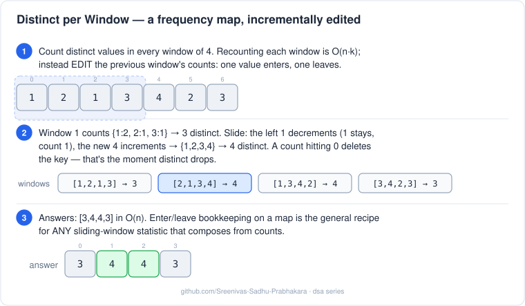

# Distinct Numbers in Every Window

> Striver SDE Sheet 149 · Day 22 Mixed — a frequency map updated by the one value entering and the one leaving; deleting zero entries keeps len() honest. Go, stdlib only, tested.

## Problem

For every window of size k, how many *distinct* values does it contain? Recounting each window costs O(n·k); sliding should cost O(1) amortized per step.

## Approach

Between adjacent windows exactly two things change: one value enters, one leaves. A frequency map absorbs both updates in O(1), and — the one subtlety — a count that drops to zero must be **deleted**, not left as a zero entry, so that `len(freq)` *is* the distinct count with no scan. This enter/leave discipline over a frequency map is the general skeleton for windowed statistics (distinct counts, anagram detection, "at most k kinds" problems); the distinct-count version is its cleanest instance.

**Complexity:** O(n) time, O(k) space.

## Visual walkthrough

Read the picture top to bottom — each numbered frame is one moment of the algorithm
running on this repo's test example.

## Run

    go test ./...   # verify
    go run .        # demo

---

One of 191 repos solving Striver's SDE Sheet in Go — stdlib only, one problem per repo, every solution tested. Browse the set: [`dsa-*` repos](https://github.com/Sreenivas-Sadhu-Prabhakara?tab=repositories&q=dsa-&type=source).
